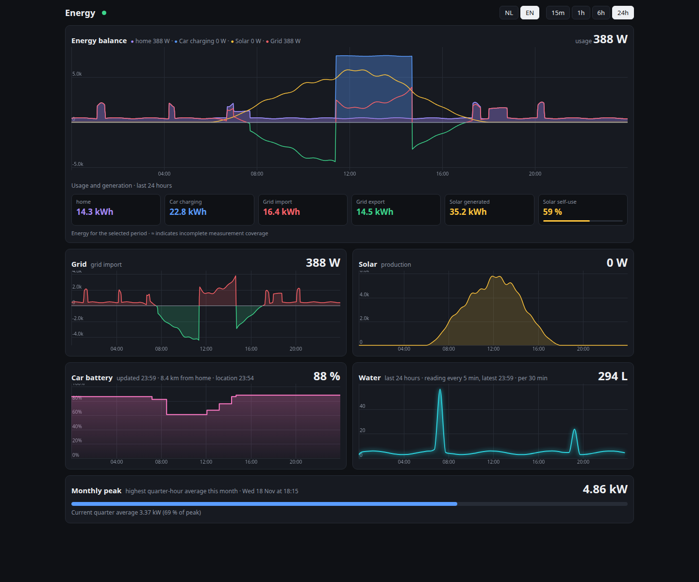
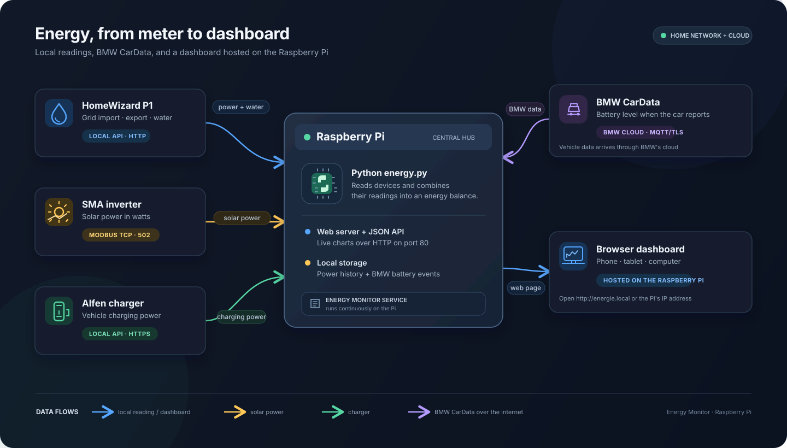

# Energy monitor

Plain Python (standard library only) that collects device readings and serves a web dashboard. The dashboard is available in English and Dutch; choose EN or NL at the top of the page.



*Example screenshot in English; all displayed readings are synthetic.*

## Architecture



The Raspberry Pi reads local meters, receives BMW CarData through BMW's cloud, stores the history, and hosts the dashboard for devices on your home network.

The dashboard offers English and Dutch. Its time-range buttons select 15 minutes, 1 hour, 6 hours, or 24 hours. The energy-balance card also totals home use, car charging, grid import, grid export, and solar generation for the selected period, plus the share of solar power used directly in the home. A `≈` marks totals with gaps in the available measurements.

| Graph | Source | Details |
|---|---|---|
| Energy balance | All-in-one: Home + Charger stacked, with Solar and Grid lines overlaid (red = import, green = export) | + / − |
| Grid | HomeWizard P1 | + import, − export |
| Solar | SMA inverter | Production, ≥ 0 |
| Car battery (optional) | BMW CarData stream | Charge level in %, distance from a configured reference point; dashed when the car has not reported recently |
| Water | Water meter connected to the P1 (optional) | Litres per time slot, drawn as a smooth wave; header shows the total for the selected range |
| Monthly peak | P1 meter (Belgian capacity tariff) | Highest quarter-hour average this month, when it occurred, and how the current quarter compares |

## Requirements

| Component | Minimum / requirement |
|---|---|
| Hardware | Any Raspberry Pi that can run Linux and Python 3.10+, including a Pi Zero. One CPU core is sufficient; allow about 100 MB of available RAM for the service, including temporary history processing. Typical memory use is in the tens of MB. |
| Software | Linux and Python 3.10 or newer; standard library only, no pip packages |
| Network | Access to configured devices on the home network; internet access for the optional BMW CarData connection |
| Dashboard | A modern browser on a phone, tablet, or computer |

The monitor samples locally at low frequency, keeps only 24 hours of readings, and needs no database or additional packages. Even an older Pi should be sufficient; the Raspberry Pi 2 has been confirmed to run it smoothly. The systemd service is optional, but is used by the installation instructions below.

## What is included

`energy.py` collects readings and serves the web page; `index.html` is the dashboard; `bmw.py` is the optional BMW CarData client. `static/` contains the app icons, manifest, and architecture diagram. `config.example.json` is an example configuration, and `energy-monitor.service` is the systemd unit.

## 1. Prepare the devices

- **HomeWizard P1**: In the HomeWizard Energy app, go to Settings → Meters → your P1 and enable **Local API**. Check that `curl http://<ip>/api/v1/data` returns JSON containing `active_power_w`.
- **Water** (optional): Connect the water meter to the P1. Enable its graph with a `water` object inside `homewizard` in `config.json`. The P1 reports the cumulative reading (m³) whenever the meter sends an update. `report_interval` defaults to 300 seconds; set it to the meter's actual reporting interval. The reported volume is spread evenly over the preceding interval and drawn as a smooth wave (1 / 2 / 10 / 30-minute points for 15m / 1h / 6h / 24h). Usage after the last report is unknown: that part is shaded ("waiting for reading"), and the header total counts up to the last report ("reported through"). Totals are exact; the meter reports in 1-litre increments. Omit `water` to hide the graph.
- **Alfen charger**: No Modbus is needed. The charger's local web API on port 443 is used (its self-signed certificate is not verified). Put the charger's web login in `config.json` (`username`, default `admin`, and `password`). If your charger allows reading without login, omit `password`.
  The charger is polled every `interval` seconds (default 10, not 1) and the monitor logs out after each reading so the Alfen app can still log in. Between polls, the last value is held. Set `"interval": 1` for 1-second polling or `"logout": false` to keep a session open (both make the charger busier).
- **SMA inverter**: In the inverter's web interface, enable the **Modbus TCP server** under Device parameters → External communication → Modbus. The default unit ID is 3, port 502.

Give each device a fixed IP address (a DHCP reservation in your router).

## 2. Configure

```
cp config.example.json config.json
```

Edit the IP addresses and credentials. Omit a device section to disable that source (a missing source counts as 0 in the "Home" calculation). Polling intervals are in seconds: HomeWizard and SMA default to 1; Alfen defaults to 10 to reduce load on the charger. Set each device's `interval` to tune it. `homewizard.water.report_interval` is different: it is the expected interval between water-meter reports, not the P1 polling rate. BMW CarData is a continuous event stream and has no polling interval. The dashboard defaults to Dutch unless the browser prefers English; its EN/NL choice is saved in that browser. Optional root keys: `port`, `bind`, `data_dir`; Alfen: `username`, `port`, `property`; SMA: `port`, `unit`, `register`, `function` (3 or 4).

## 3. Run on a laptop (try it out)

Create `config.json` as above, and change `"port": 80` to `"port": 8080` (ports below 1024 normally require root).

```
python3 energy.py config.json
```

Open `http://localhost:8080`, or on your phone `http://<laptop-ip>:8080`. The console prints `grid: ok` / `grid: ERROR …` whenever a source changes state, including the exception type. BMW errors include the retry delay; new stream data logs sample keys, making it easier to find the battery field your car reports.

## 4. Install on a Raspberry Pi (or any systemd Linux)

Raspberry Pi OS Lite (or Debian netinst) with SSH is sufficient; nothing else needs to be installed.

```
sudo mkdir -p /opt/energy-monitor
sudo cp -r energy.py bmw.py index.html static config.json /opt/energy-monitor/
sudo cp energy-monitor.service /etc/systemd/system/
sudo systemctl daemon-reload
sudo systemctl enable --now energy-monitor
journalctl -u energy-monitor -f        # watch it start
```

Then open `http://<pi-ip>` (port 80, so there is no need to type `:8080`). The service unit lets its temporary service user listen on port 80 (`AmbientCapabilities=CAP_NET_BIND_SERVICE`).

### Use a hostname instead of an IP address

```
sudo hostnamectl set-hostname energie
sudo apt install avahi-daemon     # only if it isn't installed yet
sudo reboot
```

Now `http://energie.local` works on iPhone and most recent Android versions. Not every Android browser resolves `.local` names. If yours does not, use the IP address (give the Pi a fixed IP in your router) and add a home-screen shortcut so you do not have to type it each time.

### Add it as an app on your Android phone

Open the page in Chrome, tap the menu (⋮) → **Add to Home screen**. If Chrome offers **Install app**, choose it to get a real app in its own window. The page includes the name ("Energie"), an icon, and a full-screen manifest. Over plain `http`, Chrome may only add a shortcut that still opens inside Chrome with the address bar; this is a Chrome limitation for non-`https` sites. The shortcut still gives you an icon and one-tap access.

To update later, copy the files again and run `sudo systemctl restart energy-monitor`.
On a system without systemd, run `python3 energy.py config.json` from your preferred init system.

## Monthly peak (capacity tariff)

Shown at the bottom when your P1 reports it (as Belgian smart meters do): the highest quarter-hour average this month, when it happened, and a bar comparing the current quarter's average with that peak (orange from 90%, red when setting a new peak). The values come from the same response the P1 already provides for grid power, so no extra request is needed; they are refreshed once a minute. Nothing needs configuring; the card stays hidden if the meter does not report a peak.

## Car battery with BMW CarData (optional)

Adds a graph of the battery charge in %. It uses BMW's own CarData stream, so no password is stored: authorize the monitor once through your BMW account.

1. On your BMW account's **CarData** page, create a client ("Create CarData Client") with both the **CarData API** and **CarData Streaming** subscriptions enabled, and copy the **client ID**.
2. On your car's CarData page, open **Data selection**, select the battery / charging data points (for example, the "Electric vehicle" group), and save. To show the car's distance from a reference point, also select both location signals:
   - `vehicle.cabin.infotainment.navigation.currentLocation.latitude`
   - `vehicle.cabin.infotainment.navigation.currentLocation.longitude`

   BMW only streams selected data, and location signals are not available for every car.
3. Add this to `config.json` (the VIN is the 17-character vehicle identification number). Set `bmw.home` to the reference coordinates as `"latitude,longitude"`; the coordinates below are an example:
   ```
   "bmw": { "client_id": "your-client-id", "vin": "WBA...", "home": "51.05,3.72" }
   ```
   The battery graph's small status text shows the distance from Home and when BMW last reported the location. The latest car coordinates are saved locally in `car-position.json` with owner-only permissions, so the distance is available after a service restart. The coordinates are not sent to the browser; distance is shown only when `bmw.home` is configured.
4. Authorize once. Run this while the service is running (it writes the tokens to the service's data folder):
   ```
   sudo STATE_DIRECTORY=/var/lib/energy-monitor python3 /opt/energy-monitor/energy.py /opt/energy-monitor/config.json bmw-login
   ```
   It prints a link and a code. Open the link on your phone or laptop and sign in to your BMW account. The service picks up the tokens automatically within about 20 seconds.
5. BMW only sends data when the car reports. Locking or unlocking the car in the MyBMW app triggers a report. Until then, the graph says "waiting for a report from the car."

Good to know:
- The stream carries many data points. The log lists the battery-related ones it sees (`bmw: N new data point(s) in the stream: …`). The monitor uses the first of these keys that your car sends: `vehicle.drivetrain.batteryManagement.header`, `vehicle.powertrain.electric.battery.stateOfCharge.displayed`, or `vehicle.trip.segment.end.drivetrain.batteryManagement.hvSoc`. Which one carries the percentage varies by model. If the graph stays empty or looks wrong, set the correct key in `"soc_keys": ["…"]` in the `bmw` section.
- BMW allows **one** stream per account. Do not run this alongside another CarData integration (Home Assistant, evcc) using the same client.
- Tokens are renewed automatically and stored in `bmw-tokens.json` (readable only by the service). If the log says `token refresh failed`, run the login command again.
- The car only reports occasionally, so the line is a step graph that holds the last value. It turns dashed when the last report is more than 20 minutes old.

## How it works / good to know

- Each polled device runs in its own thread at its configured interval; one sample per wall-clock second is stored (integer watts). A reading is marked missing once it is older than the greater of 5 seconds and two polling intervals plus 2 seconds. If only the charger is offline, total consumption (grid + solar) remains visible and is drawn in grey as "home + charger, split unknown"; if the grid or solar source is offline, consumption is a gap. The page lists offline sources at the top.
- The last 24 hours live in memory (~86,400 samples, a few MB). They are appended to `samples-v3.bin` once a minute and trimmed to 24 hours hourly, minimizing SD-card wear; a restart loses at most a minute. The latest BMW location is saved separately in `car-position.json`, without a location history. Location: `data_dir`, otherwise `$STATE_DIRECTORY` (systemd: `/var/lib/energy-monitor`), otherwise `./data`.
- The page loads history once (10-second buckets), then fetches only new samples every second. Tap or hover over a graph to read values at that time. The buttons 15m (default) / 1h / 6h / 24h switch the time range because a one-second change is less than a pixel on a 24-hour axis.
- "Home" is clamped at 0 because the devices are not sampled at exactly the same instant. Solar and charger readings are clamped at ≥ 0 (standby noise).
- There is no authentication: keep it on your home network and do not forward its port from the internet.

## If a value looks wrong

- **Alfen**: The power value is API property `2221_16` (socket 1 total active power, W). If the charger has a second socket or a different model, set `"property"` in the `alfen` section. `login failed` means the username or password is wrong; the charger only allows a few simultaneous sessions, so avoid logging in elsewhere with the same account while testing.
- **SMA**: The Modbus register numbers (total AC power 30775, S32, unit 3) are documented defaults but can differ by model or firmware. Override `register`, `unit`, and `function` and compare with your inverter's Modbus documentation. Most firmware responds to function 3; try `"function": 4` if it does not.
